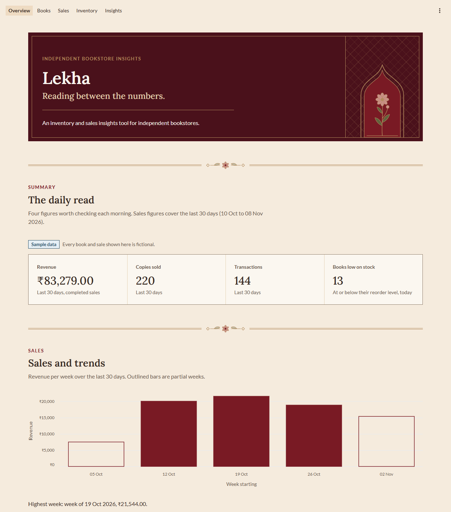
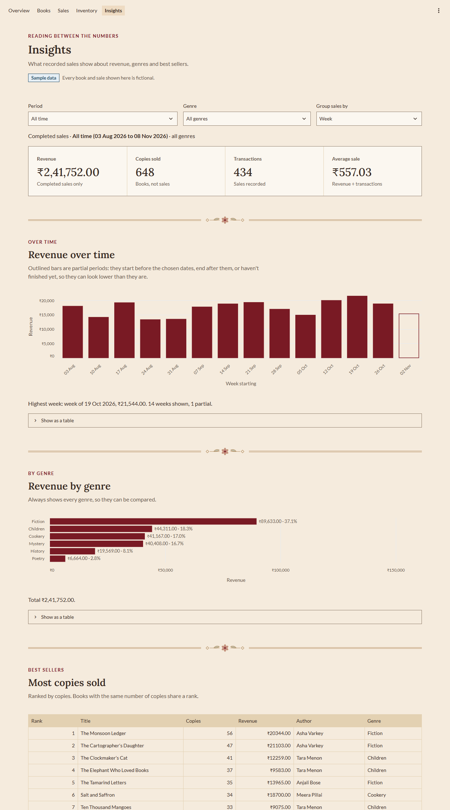
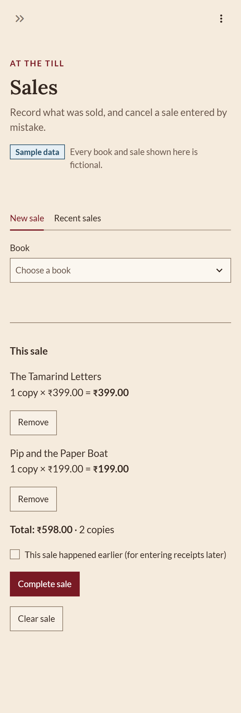

# Lekha

**Reading between the numbers.**

[](https://github.com/priyal-baraya/lekha/actions/workflows/tests.yml)

An inventory and sales insights tool for independent bookstores, built with **Python, SQLite, SQL, pandas and Streamlit**.

Lekha helps a small bookstore owner answer everyday questions from their own records: *What sells? Which genres earn the most? What's running low? What hasn't moved?* It records books, sales and stock corrections safely, and turns them into figures that were checked by hand before they were trusted. Its look draws on Indian illustrated manuscripts: crimson and Persian teal on parchment, Lora and Lato type, square editorial layout.

> **All data shown is fictional.** Every book, author, ISBN and sale in this repository and its screenshots is invented.



## What it does

| Page | For the owner | Under the hood |
|---|---|---|
| **Overview** | The day's key figures: revenue, copies, transactions (last 30 days), books low on stock, weekly trend | Same analytics code as Insights, so the two pages always agree |
| **Books** | Search by title or author, filter by genre, sort; add and edit books | Every problem listed at once; prices converted to paise exactly with `Decimal`; search text passed as SQL parameters, never pasted into SQL |
| **Sales** | Build a sale in a basket, complete it, cancel a mistaken sale | Sale, lines and stock reduction in **one transaction**; stock checked and reduced in a single `UPDATE … WHERE stock >= n`; cancelling returns stock exactly once |
| **Inventory** | Books at or below their reorder level; correct stock after a count, with a reason | Every correction recorded with before/after counts; refused if the stock changed since the page loaded |
| **Insights** | Revenue over time, revenue by genre, best sellers, unsold books, estimated gross profit, plain-language observations, for any period and genre | Readable SQL files sharing one definition of "a completed sale in the period"; `RANK()` for ties; partial periods marked; every figure tested against hand calculations |

<p>
  
  
</p>

*Screenshots use the generated **demo** dataset (30 fictional books, about 14 weeks of fictional sales) so the charts have something to show. The tests use a smaller, hand-checked sample dataset.*

## How it's built

```
views/       Pages: what the owner sees (Streamlit)
   │  call
services/    Rules: books, sales, inventory, analytics, money (plain Python, no Streamlit)
   │  run SQL through
database.py  One connection function: foreign keys on, path from LEKHA_DB_PATH
   │
SQLite       5 STRICT tables with CHECK, UNIQUE and foreign-key rules (sql/schema.sql)
```

Keeping SQL out of the pages means the rules are tested without a browser, reused across pages, and untouched by a redesign.

## Quality

- **192 automated tests** (pytest), run on every push and pull request by GitHub Actions:
  rules the database must refuse, transactions that must roll back, every analytics figure against numbers worked out by hand, and the pages themselves via Streamlit's `AppTest` (including a 2-copy sale through the real Sales page that must reduce stock by exactly 2).
- **Accessibility:** a contrast audit of every piece of text on every page went from 37 failures to 0 (WCAG 2.2 AA, 4.5:1); visible keyboard focus; charts with alt text, tooltips, written summaries and table views; layouts checked at 1280px and 375px.
- **Graceful errors:** database problems and unexpected errors show a plain message, not a traceback; details go to the terminal.

## Run it

Requires Python 3.13. Full instructions for Windows, macOS and Linux, with common problems, are in **[docs/setup.md](docs/setup.md)**. On Windows:

```powershell
git clone https://github.com/priyal-baraya/lekha.git
cd lekha
python -m venv .venv
.\.venv\Scripts\python.exe -m pip install -r requirements.txt
.\.venv\Scripts\python.exe database.py --reset-sample
.\.venv\Scripts\python.exe -m streamlit run app.py
```

Then open http://localhost:8501.

| Task | Command |
|---|---|
| Run the tests | `.\.venv\Scripts\python.exe -m pytest` |
| Build the larger demo dataset | `.\.venv\Scripts\python.exe demo_data.py`, then set `$env:LEKHA_DB_PATH = "data\demo.db"` before starting the app |
| Practise SQL on the sample data | `.\.venv\Scripts\python.exe query.py sql\01_first_queries.sql` |

## Project structure

```
lekha/
├── app.py                  Entry point: page setup, styles, navigation, error handling
├── database.py             Connection, schema set-up, sample-data reset
├── demo_data.py            Generates the larger fictional demo dataset
├── query.py                Runs SQL and prints the results (learning tool)
├── services/               Business rules: books, sales, inventory, analytics, money
├── views/                  One file per page
├── ui/                     Shared page pieces, charts, styles, SVG ornaments
├── sql/
│   ├── schema.sql          Tables and rules
│   ├── analytics/          The analytics queries, one commented file each
│   └── 01_first_queries.sql
├── data/sample_data.sql    The small, hand-checked fictional dataset
├── tests/                  192 pytest tests
├── scripts/                Screenshot capture (development only)
├── .github/workflows/      Runs the tests on GitHub
└── docs/                   Case study, setup, schema, analytics, design, decisions, logs
```

## Documentation

- **[Case study](docs/case-study.md)**: the problem, the design, the SQL, the results and the limits, in one read
- [Setup guide](docs/setup.md)
- [Product brief](docs/product-brief.md) · [Database schema](docs/schema.md) · [Sample data](docs/sample-data.md) · [Analytics definitions](docs/analytics.md)
- [Design system](docs/design-system.md) · [Decision log](docs/decision-log.md) · [Testing log](docs/testing-log.md) · [Dev log](docs/devlog/)

## Limitations

- One shop, one user, on one computer: no logins, no multi-store support.
- No deliveries or supplier records yet ("delivery received" is a stock-correction reason), so stock can't be rebuilt from history, and profit uses each book's *current* cost.
- No partial returns or discounts.
- Numbers inside tables and chart axes use Western digit grouping (₹1,047.00); elsewhere Indian grouping (₹1,11,444.00).
- Observations describe recorded sales; they can't prove causes, and say so.
