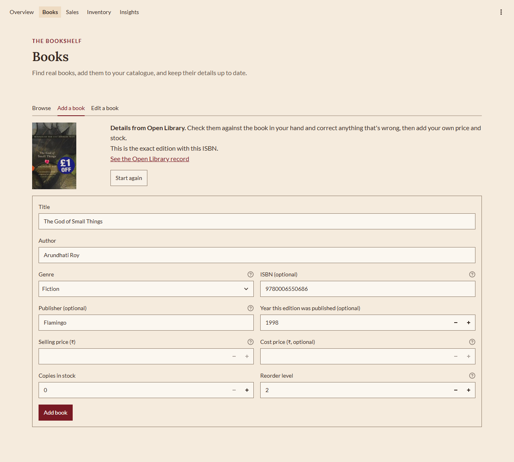
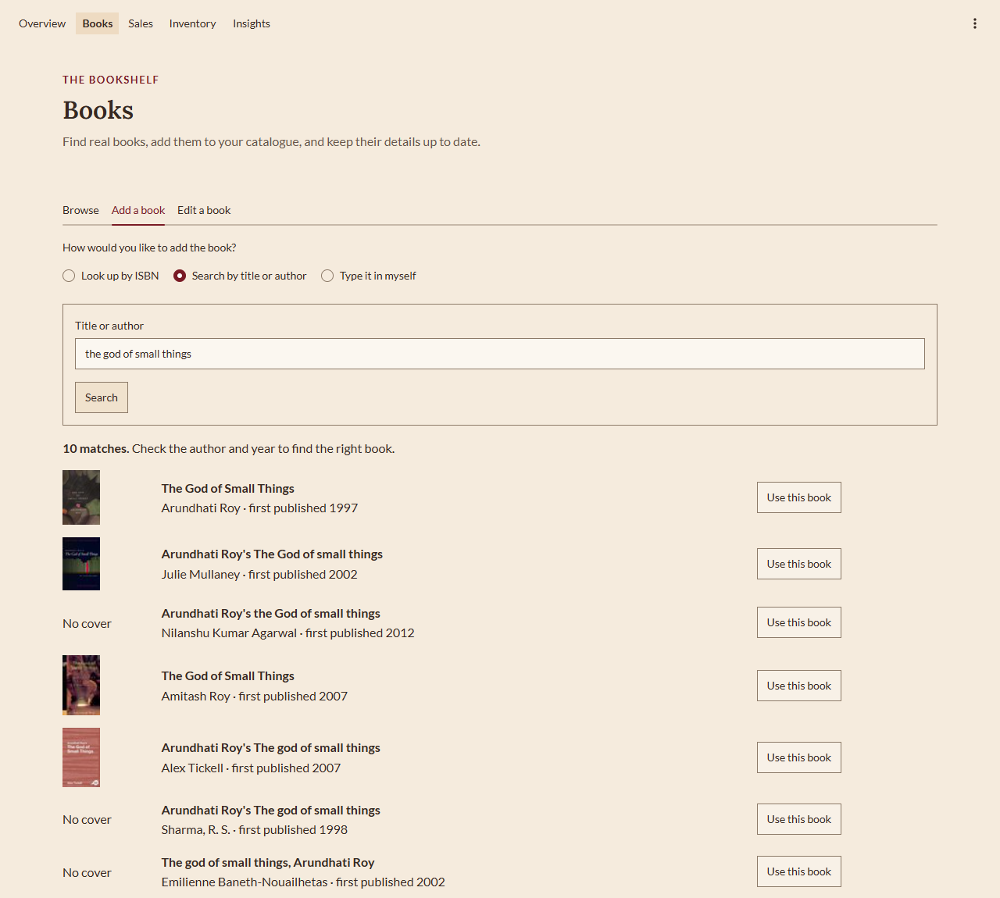
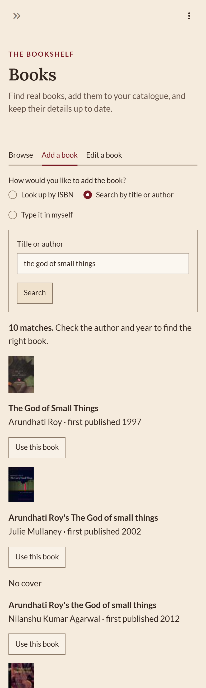

# Lekha

**Reading between the numbers.**

[](https://github.com/priyal-baraya/lekha/actions/workflows/tests.yml)

An inventory and sales insights tool for independent bookstores, built with **Python, SQLite, SQL, pandas and Streamlit**, with real book details from **[Open Library](https://openlibrary.org)**.

Lekha helps a small bookstore owner answer everyday questions from their own records: *What sells? Which genres earn the most? What's running low? What hasn't moved?* Each person signs in (with a username and password, or with Google), starts a shop or joins one with an invite code, and sees only their own shops. Owners invite staff, who can sell and add books but can't change prices, correct stock or see profit. Books are found in Open Library's real catalogue (by ISBN or by title), prices and stock come from the owner, and every figure is calculated from sales actually recorded. Nothing in the app is invented: there are no sample books, made-up sales or reviews. Its look draws on Indian illustrated manuscripts: crimson and Persian teal on parchment, Lora and Lato type, an editorial layout with slightly rounded corners.



## What it does

| Page | For the owner | Under the hood |
|---|---|---|
| **Books** | Look up a book by ISBN, search Open Library by title or author, or type it in; browse, search (by title, author or ISBN), filter and edit the catalogue, with covers and stock in words | Open Library answers pre-fill the form for checking; edition facts (publisher, year) saved only from an exact ISBN match; prices converted to paise exactly with `Decimal` |
| **Sales** | A till: type or scan to find a book, adjust copies, record the sale (or Undo it), and cancel a past sale with a reason | Sale, lines and stock reduction in **one transaction**; stock checked and reduced in a single `UPDATE … WHERE stock >= n`; cancelling returns stock exactly once |
| **Inventory** | Books at or below their reorder level; correct stock after a count, seeing the change before saving, with a reason | Every correction recorded with before/after counts; refused if the stock changed since the page loaded |
| **Insights** | Revenue over time, revenue by genre, best sellers, unsold books, estimated gross profit, plain-language observations, for any period and genre | Readable SQL files sharing one definition of "a completed sale in the period"; `RANK()` for ties; partial periods marked; every figure tested against hand calculations |
| **Overview** | One sentence about today, three figures with fair comparisons, books to reorder, the latest sales and what's selling this week | Same analytics code as Insights; a shop with no sales sees the steps to get started |
| **Sign in** | Username and password, or Google; start a shop or join one with a code; switch between shops | Passwords stored only as salted **scrypt** hashes; 5 wrong tries lock the account for 15 minutes; Google through Streamlit's built-in OpenID Connect sign-in |
| **Team** (owners) | Invite staff or co-owners with a one-time code, change roles, remove people | Codes stored as SHA-256 hashes, single-use, valid 7 days; a shop can never lose its last owner |
| **Settings** | Shop name and default reorder level (owners); your name and password (everyone) | Every permission checked in the services too, not only by hiding buttons |

**Who can do what.** Owners can do everything. Staff can look up and add books, record and cancel sales, see stock and low-stock alerts, and see Insights without profit. Sales, cancellations and stock corrections record who made them.

<p>
  
  
</p>

*Screenshots show a new, empty shop and live Open Library results, taken just before sign-in was added (so without the account menu). Open Library is edited by volunteers, so results can include study guides, translations and the occasional mistake, which is why the owner checks the details before saving.*

## How it's built

```
views/       Pages: what the owner sees (Streamlit)
   │  call
services/    Rules: accounts, permissions, books, sales, inventory, analytics,
             money, Open Library (plain Python, no Streamlit)
   │  run SQL through
database.py  Connections with foreign keys on; picks the signed-in person's shop
             file; numbered migrations tracked with PRAGMA user_version
   │
SQLite       data/accounts.db       people, shops, roles, invite codes
             data/shops/shop_N.db   one file per shop: 5 STRICT tables with
                                    CHECK, UNIQUE and foreign-key rules
```

Keeping SQL and network calls out of the pages means the rules are tested without a browser or the internet, reused across pages, and untouched by a redesign. Giving each shop its own file means one shop's query can't reach another shop's books, even by mistake.

## Quality

- **444 automated tests** (pytest), run on every push and pull request by GitHub Actions: sign-in, lockout, invite codes and every role's limits, two shops that must never see each other's books, rules the database must refuse, transactions that must roll back, every analytics figure against numbers worked out by hand, Open Library lookups replayed from **real saved responses** (so the tests don't need the internet), a schema migration that must keep existing data, and the pages themselves via Streamlit's `AppTest`, including adding a real book by ISBN and a 2-copy sale that must reduce stock by exactly 2.
- **Test data stays in the tests.** The analytics are checked against a small, hand-calculated fictional dataset (`data/sample_data.sql`). It is loaded only into temporary test databases, never into the app.
- **Accessibility:** a contrast audit of every piece of text on every page went from 37 failures to 0 (WCAG 2.2 AA); visible keyboard focus; charts with alt text, tooltips, written summaries and table views; layouts checked at 1280px and 375px.
- **Security** ([details](docs/security.md)): scrypt password hashes, lockout after 5 wrong passwords (also on the change-password form), limits on repeated sign-ins, sign-ups and invite codes, sign-out after 60 idle minutes or a password change elsewhere, roles checked in the services, names and Open Library text escaped so they can't inject formatting, links or pictures, Open Library answers checked before use, and only this computer can open the app by default. GitHub checks every package for known vulnerabilities (**pip-audit**) and scans the code (**bandit**) on every push and weekly; Dependabot proposes updates.
- **Graceful errors:** database problems, an unreachable Open Library and unexpected errors all show a plain message, not a traceback.

## Run it

Requires Python 3.13, and an internet connection for looking books up. Full instructions for Windows, macOS and Linux are in **[docs/setup.md](docs/setup.md)**. On Windows:

```powershell
git clone https://github.com/priyal-baraya/lekha.git
cd lekha
python -m venv .venv
.\.venv\Scripts\python.exe -m pip install -r requirements.txt
.\.venv\Scripts\python.exe -m streamlit run app.py
```

Then open http://localhost:8501, create an account, start your shop, and add your first book on the **Books** page. To add "Sign in with Google", follow [Google sign-in](docs/setup.md#optional-google-sign-in) in the setup guide.

| Task | Command |
|---|---|
| Run the tests | `.\.venv\Scripts\python.exe -m pytest` |
| Start again from nothing (deletes every account and shop; asks first) | `.\.venv\Scripts\python.exe database.py --reset` |
| Practise SQL on the test dataset (in memory, nothing saved) | `.\.venv\Scripts\python.exe query.py --sample sql\01_first_queries.sql` |

## Project structure

```
lekha/
├── app.py                  Entry point: who's signed in, their shop and role, the
│                           pages they may see, error handling
├── database.py             Connections, schemas, migrations, per-shop files, reset
├── query.py                Runs SQL and prints the results (learning tool)
├── services/               Business rules: accounts, permissions, books, sales,
│                           inventory, analytics, money, Open Library lookups
├── views/                  One file per page
├── ui/                     Shared page pieces, sign-in state, charts, styles, ornaments
├── sql/
│   ├── schema.sql          A shop's tables and rules
│   ├── accounts_schema.sql People, shops, roles and invite codes
│   ├── migrations/         Numbered schema changes, applied once each
│   ├── analytics/          The analytics queries, one commented file each
│   └── 01_first_queries.sql
├── data/sample_data.sql    The fictional, hand-checked dataset the tests use
├── tests/                  444 pytest tests; fixtures/ holds real Open Library responses
├── scripts/                Screenshot capture (development only)
├── .github/workflows/      Runs the tests on GitHub
└── docs/                   Case study, setup, schema, analytics, design, decisions, logs
```

## Documentation

- **[Case study](docs/case-study.md)**: the problem, the design, the SQL, the results and the limits, in one read
- [Setup guide](docs/setup.md)
- [Product brief](docs/product-brief.md) · [Database schema](docs/schema.md) · [Test dataset](docs/sample-data.md) · [Analytics definitions](docs/analytics.md)
- [Security](docs/security.md) · [Design system](docs/design-system.md) · [Decision log](docs/decision-log.md) · [Testing log](docs/testing-log.md) · [Dev log](docs/devlog/)

## Data and credits

- **Book details and covers** come from [Open Library](https://openlibrary.org), an open catalogue run by the Internet Archive and edited by volunteers. Lekha pre-fills them; the owner checks them.
- **Prices, stock and sales** come only from the owner. No API knows a particular shop's prices or sales, so Lekha never guesses them.
- **Reviews and ratings** are not shown.

## Limitations

- Runs on one computer (or one server). Several people and shops can share it, but it isn't hosted online yet, and it has no HTTPS of its own, so by default only the computer it runs on can open it (see [Letting other devices in](docs/setup.md#letting-other-devices-in)).
- A username-and-password sign-in lasts until the browser tab is refreshed or closed; Google sign-in is remembered by a browser cookie.
- Google sign-in is built and its account rules are tested, but the round trip to Google itself is only tried once Google credentials are set up (see the setup guide).
- No "forgot password" by email: an owner can't reset a password yet, so a forgotten one means a new account.
- Looking books up needs the internet; typing a book in works offline.
- No deliveries or supplier records yet ("delivery received" is a stock-correction reason), so stock can't be rebuilt from history, and profit uses each book's *current* cost.
- No partial returns or discounts.
- Numbers inside tables and chart axes use Western digit grouping (₹1,047.00); elsewhere Indian grouping (₹1,11,444.00).
- Observations describe recorded sales; they can't prove causes, and say so.
